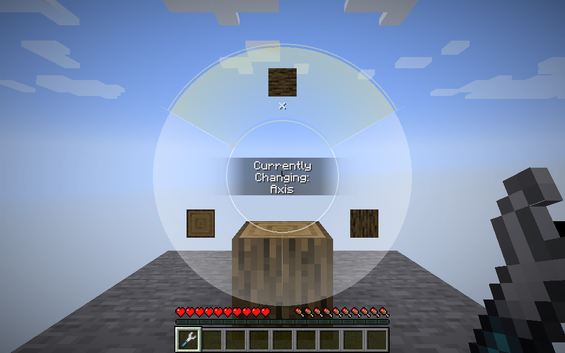

# Alpha.14 cross-version callback and server changes

All six builds share read-only native tool projections, real-source borrowing with mode restoration, native API metadata caching, bounded/coalesced UI requests, exception-aware container returns, and an interaction scope for permission checks and optional native audit writes. These features keep the universal wrench physically held.

The Create rotation wheel is available on **Forge 1.20.1 with Create 6.0.8** and **NeoForge 1.21.1 with Create 6.0.10**. It uses Create's own key binding, screen, camera-relative previews and native commit code. Source removal, profile changes, invalid properties, stale orientations and protection vetoes prevent a commit. Existing unrelated properties and block entity contents are preserved.

| Build | Native mod checks | Create wheel |
| --- | --- | --- |
| Forge 1.12.2 | AE2 and Mekanism; stored AE2 menus | No compatible official Create release |
| Forge 1.16.5 | AE2 and Mekanism; stored AE2 menus | The official 1.16 branch has no radial wrench menu |
| Forge 1.20.1 | AE2, Mekanism and Create 6.0.8; stored AE2 menus | Native screen and authenticated native packet |
| NeoForge 1.21.1 | Existing full native-mod lab, Create 6.0.10 and native GriefLogger audit checks | Native screen and authenticated native packet |
| NeoForge 26.1.2 | AE2 and stored AE2 menus | No official Create artifact for this game version at verification time |
| NeoForge 26.2 | AE2 and stored AE2 menus | No official Create artifact for this game version at verification time |

Create availability was checked against the [official published versions](https://modrinth.com/mod/create/versions) and [official 1.16 source tree](https://github.com/Creators-of-Create/Create/tree/mc1.16/dev/src/main/java/com/simibubi/create/content/contraptions/wrench). This release does not invent a menu for an upstream version that lacks it. Other Create forks need their own validation.

## Port checks

The five additional ports passed their existing dedicated-server suites: shared and simulated actions in both hands, real source costs, mode restoration, held-item replacement rejection, full inventories, carried containers, native AE2 card menus and protection checks. The Forge ports exercised real AE2/Mekanism machines; the 26.x ports exercised real AE2.

New checks in each port cover read-only projections and the shared execution helper in both hands, duplicate/distinct mode request budgets, coalesced catalog and source requests, delivery of the latest source nonce and state, and scoped permission/audit behavior. Test sources are excluded from both release JAR types.

Forge 1.20.1 additionally passed 18 native Create server cases and eight integrated client cases: ordinary/container sources in either hand, hidden source status, source removal, profile changes, the original physical wrench, and key-release submission. The native packet's actual Forge sender context is used synchronously on the server thread. Vanilla rotation properties use compiled references so Forge can remap their fields; the client injection points also have production refmap entries.

Create 6.0.8's [native preview renderer](https://github.com/Creators-of-Create/Create/blob/mc1.20.1/dev/src/main/java/com/simibubi/create/content/contraptions/wrench/RadialWrenchMenu.java) reads and changes a block entity's level even when an ordinary block has no block entity. The compatibility hook skips those null-only calls. It preserves the native renderer and also lets the original physical Create wrench render those previews.

Results are in [alpha14-ports](alpha14-ports/). Earlier 1.21.1 coverage is recorded in the [server review](alpha14-server-review.md) and [native callback verification](native-tool-proxy.md). These are bounded compatibility checks; they do not establish a whole-server MSPT improvement or support for arbitrary third-party key bindings and screens. Native GriefLogger integration was exercised on 1.21.1; the other ports' audit scope checks use fixture callbacks.

## Reproduction

Use the Java toolchains described in the repository README. From the Forge 1.12.2 directory run `gradlew runServer -PportVerification -PnativeVerification`. The other additional ports use `gradlew runVerificationServer -PnativeVerification`. Add `-PcreateVerification` for the Forge 1.20.1 Create suite; its isolated client uses `runNativeProxyClient` with both properties and a prepared `Native-Proxy-Check` test world.

Always inspect the result JSON/text. A fixture failure can still end the game normally and let Gradle report a successful task. Server records were generated while the port still had its previous local build label, before the final version-label and formatting pass.
