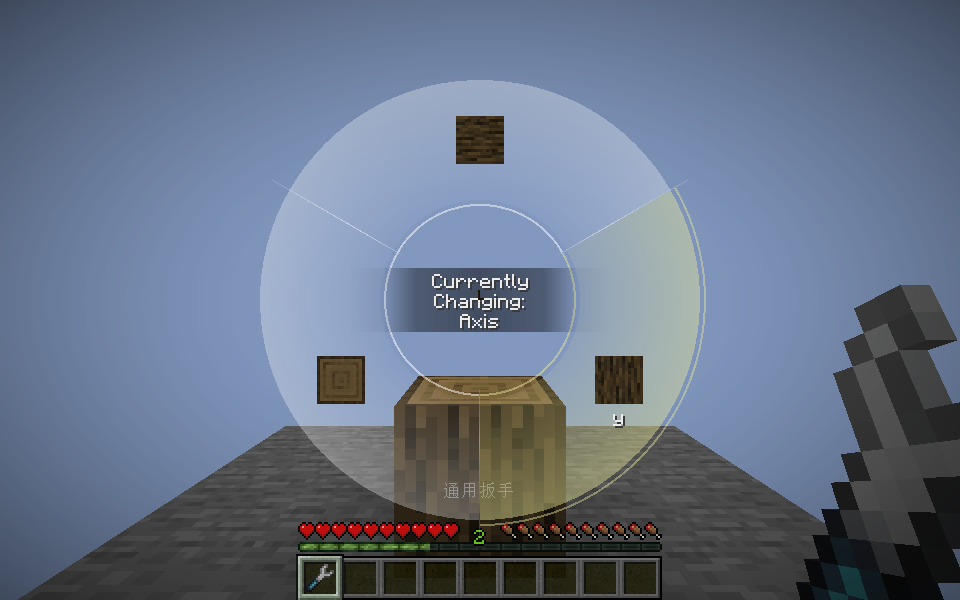

# Native tool callback prototype

Preview `0.1.0-alpha.14-dev.2`, Minecraft 1.21.1 / NeoForge. This is a local prototype, not a published release. Its Wrench Bridge network protocol is **7**; use this build on both sides of a temporary multiplayer test. The other Minecraft ports have not received this prototype.

Runtime artifact SHA256: `e8a8c94a31d6468b1f954452218a8ca52668d939b7a703ab5c8da323e4fb7acb`. The [packaging record](native-tool-proxy/jar-verification.json) checks the tested compiled classes, verification-source exclusion, and unchanged author texture.

## Try the native Create wheel

1. Carry a Create wrench in the ordinary inventory or a supported carried container, including Sophisticated Backpacks.
2. Hold the universal wrench and use its mode menu to select the Create wrench simulation. Either hand works; the normal first-universal-hand priority is retained.
3. Bind Create's **Open Block Rotation Menu** action in Minecraft's controls if it is unbound. The bridge uses that native binding and does not assign another default key.
4. Look at a block supported by Create's rotation menu, hold the binding, choose an orientation, then release the key or click to submit. Native cancellation behavior is retained.

The displayed wheel is Create's own screen, including its block previews and scrolling between supported properties. The universal wrench remains in the actual hand. The real source is borrowed on the server and returned; Create's wrench has no native rotation cost to charge. Removing the source or changing the profile prevents a stale menu from committing a rotation.



## Reusable pieces

- `NativeToolViews` builds a copy of a real source with the selected simulated mode. It contains no Create- or Mekanism-specific dispatch.
- `NativeClientViews` supplies the same bounded source snapshots to input and render consumers. The **source tooltip/status** switch still hides those UI details; it no longer disables source transport needed by a native callback.
- `NativeClientCallbacks` scopes opted-in native hand reads to one declared `NativeInputRule`. It does not patch global player inventory access or `ItemStack.getItem`, and does not inspect a Java stack trace on item queries.
- `NativeScreenConstructionMixin` recognizes declared screens constructed during such a callback. This matters because Create's `ScreenOpener` queues display for a later frame: the input scope has already ended when the wheel appears. A weak screen binding retains the selected hand, actual held stack, world, target, original state, and profile until close.
- `NativeToolExecution` now owns the real-source borrowing, temporary mode selection/restoration, and held-item replacement guard for both existing right-click simulations and native GUI commits.
- `NativeBlockActions` owns request bounds/rate limits, source authentication, interaction/edit vetoes, and native feedback scope. A small `NativeBlockProtocol` supplies a source identity, a valid state projection, and the native apply entry.

The Create profile provides the input call-site binding and native screen submission hook. Its server policy accepts a single change to one of the seven property objects used by the tested native menu, rejects its native block blacklist, checks reach and loaded chunks, and revalidates the current orientation. Other current properties are preserved rather than overwritten from an old GUI snapshot. The final apply invokes Create's own packet handler, preserving its kinetic updates, neighboring shapes, and sound.

Mekanism's face overlay now consumes this shared view path, with full real-source data instead of constructing an empty configurator from a catalog-presence result. Existing AE2 menu/locator and stored-card adapters remain in place; they have additional source-binding requirements.

## Verification

Pinned native versions include Create 6.0.10 and Mekanism 10.7.19.85. Results are stored in [native-tool-proxy](native-tool-proxy/).

- Common logic: 17 existing unit tests.
- Existing native-mod server regression: real source costs, mode restoration, both hands, stored AE2 menus, protection, depletion, and 71 feedback comparisons.
- New server coverage: 18 cases covering ordinary/backpack sources in both hands, native handler invocation exactly once, edit and interaction denial, wrong mode, missing source, invalid/different/stale states, non-rotation or multiple property changes, out-of-reach requests, unknown actions, preserved hopper contents and waterlogging, and an eight-action burst followed by 1,000 rejected excess requests.
- Native client coverage: eight integrated-connection cases, using the real Create key handler and wheel. These include main/offhand inventory and backpack sources, source-details disabled, source removal after opening, a profile change while open, unchanged original-wrench behavior, and native key-release submission.
- Existing client regression: 53 scenarios, including actual Mekanism face-overlay render frames, both hands, selected transmissions, backpack sources, missing-source/shared-mode rejection, AE2 menus and native feedback. Each positive Mekanism overlay case rendered 45 native overlay frames; missing-source/shared cases rendered none.

All verification game JVMs use a 2 GiB heap. The dedicated server check uses NeoForge 21.1.244 with GriefLogger 1.2.9 and zxcopt 1.8.0; client and the complete existing native lab use NeoForge 21.1.248 because the pinned Supplementaries build requires 21.1.247+. The audit is checked against durable SQLite rows separately.

Opt-in local commands, with JDK 21 and the pinned native lab mods installed in the relevant isolated run directories:

```powershell
# From the repository root
.\gradlew.bat :test

# From versions/neoforge-1.21.1
.\gradlew.bat runVerificationServer -x downloadAssets
.\gradlew.bat runNativeProxyClient -x downloadAssets
.\gradlew.bat runVerificationClient -x downloadAssets
```

The client fixture uses the separate `run-native-proxy-client` directory and `Native-Proxy-Check` world. Its R binding and display options are test-profile settings. Always inspect the fixture result JSON/text; a normal game shutdown can still make Gradle report success after a failed fixture.

## Boundaries

This establishes reusable callback views, screen lifetime binding, and an authenticated execution path. It does **not** automatically discover and support arbitrary mods or all Create interactions. Further callbacks need declared entry rules; custom menus, donor slot locators, packets, or extra rotation properties can still require protocol-specific policies. Unknown method names are never tried as gameplay actions.

Only the bound universal-wrench wheel is rerouted through the new action path. The original tool's GUI and unrelated native packets retain their original behavior. The synthesized interaction event is the key action's protected interaction; the bridge's normal right-click adapter is skipped for that event, cancellations are honored, and the physical universal item stays visible to listeners. The existing scoped GriefLogger journal prevents edit checks for a rotation from becoming false break/container-removal records.

Real FTB Chunks integration and complete-pack multiplayer/load validation remain separate work. No MSPT improvement, all-version coverage, arbitrary-protocol compatibility, deployment, or publication is claimed by this prototype.
